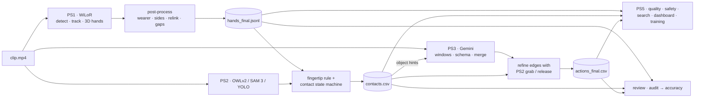

# HandTrace — Egocentric Vision for Factory Video

**From first-person factory video to tracked hands, hand-object contacts, task-step timelines and usable insights, in one linked, resumable pipeline.**

Built for the **Egocentric Vision Hackathon (BIOS × MytronLabs)**.

| | Problem statement | Output |
|---|---|---|
| **PS1** | Hand tracking: each of the camera wearer's hands, left/right, 21 keypoints, persistent IDs | `hands_final.jsonl` |
| **PS2** | What is the hand touching: nothing / portable / fixed, object name and box, grab/release timeline | `ps2_final/contacts.csv` |
| **PS3** | Task-step timeline: actions with start, end, verb, object and hand | `ps3/actions_final.csv` |
| **PS5** | Video to insight: quality filter, safety monitor, plain-English search, dashboard, training videos | `ps5/`, `ps5_dashboard.html` |

---

## Pipeline



Every stage reads the previous stages' files: PS2 uses PS1's fingertips, PS3 snaps its step boundaries to PS2's grab/release frames, and PS5 combines everything. Details: [docs/architecture.md](docs/architecture.md).

## Key features

- **Hand tracking with WiLoR (CVPR 2025):** official detector and 3D reconstruction at a pinned commit; two-stage tracker; One-Euro smoothing; gap interpolation.
- **Whole-clip post-processing:**
  - removes background workers' hands and duplicate boxes;
  - fixes left/right by a vote over each track;
  - relinks a hand that leaves the frame and comes back;
  - re-reconstructs hands whose side was corrected.
- **Open-vocabulary contact detection:**
  - per-workspace prompt profiles, each object mapped to portable / fixed / unknown;
  - the hackathon fingertip rule, ranked so a tool held above a table counts as a grab;
  - optional mask-aware contact with SAM 3;
  - a temporal state machine that turns contacts into grab/release and touch-start/end intervals.
- **Gemini task timeline:**
  - fixed verb vocabulary enforced by a JSON schema;
  - overlapping windows, with time-base detection and recovery from truncated replies;
  - API responses cached and uploads deleted after each clip;
  - step boundaries refined with PS2, plus checks for missing / out-of-order steps and a comparison of two workers.
- **Insight tools:** blur / dark / hand-less detection, hand-near-hazard stretches, offline plain-English search, a numbers-only dashboard, and captioned training cuts.
- **Review and evaluation:** frame inspector widget, standalone HTML player (numbers only), hard-moment navigation, raw vs post-processed comparison, and a manual audit that produces recall, precision, side accuracy and keypoint-OK rate.
- **Engineering:** resumable multi-GPU workers with lock files, session time budget, one CLI, lazy heavy imports, 100+ synthetic tests and a repo-hygiene guard.

## Repository structure

```
├── handtrace/                 the package
│   ├── cli.py                 python -m handtrace.cli {ps1|ps2|ps3|ps5|all}
│   ├── runner.py              resumable multi-GPU PS1 / PS2 workers, summaries, packaging
│   ├── environment.py         dependency install that keeps torch/CUDA, secrets
│   ├── postprocess.py         PS1 post-processing (pure Python)
│   ├── results.py             where every stage writes; shared loaders
│   ├── render.py              demo segments and private review sheets
│   ├── review.py, review_widgets.py, review_html.py   manual review and audit
│   ├── io.py                  frame access for the local labelling tools
│   ├── wilor/                 PS1: detector, tracker, reconstruction, smoothing, pipeline, refine, setup
│   ├── ps2/                   PS2: object detector, object tracker, contact rule, state machine, masks, pipeline
│   ├── ps3/                   PS3: windows, prompt, Gemini client, schema, validation, merge, refinement, compare
│   └── ps5/                   PS5: index, search, quality, safety, dashboard, training
├── notebooks/HandTrace_Final_Pipeline.ipynb   Kaggle reproducibility + demo notebook (imports the package)
├── configs/                   ps2_objects.json (object vocabulary), example_config.json (CLI settings)
├── scripts/                   setup.sh, run_pipeline.py, run_demo.py, package_results.py
├── eval/                      metrics.py, label.py, label_events.py, contact_metrics.py
├── tests/                     test_ps1 · test_ps2 · test_ps3 · test_ps5 · test_pipeline · test_repo_hygiene
├── docs/                      architecture · methodology · evaluation · data_policy · problem_statements
├── data/README.md             your private clips go here (gitignored)
└── outputs/                   pipeline outputs (gitignored)
```

## Installation

**Kaggle (recommended):** nothing to install by hand; see [Run on Kaggle](#run-on-kaggle).

**Linux with a CUDA GPU:**
```bash
git clone https://github.com/Avneetbhatia12/BiosHack.git && cd BiosHack
# 1. install PyTorch for your CUDA version: https://pytorch.org/get-started/locally/
# 2. download MANO_RIGHT.pkl from https://mano.is.tue.mpg.de (accept the licence) into data/
bash scripts/setup.sh WiLoR data      # requirements, ultralytics (no-deps), editable install, WiLoR + weights + MANO
```

**CPU only** (post-processing, PS3, PS5, review, tests):
```bash
pip install -e ".[ps3,review,dev]"
pytest
```

## Configuration

| Where | What |
|---|---|
| `configs/example_config.json` | CLI settings (clips, output folder, stages, precision mode, detector size, object backend, PS3 model, workers). Flags override it |
| `configs/ps2_objects.json` | PS2 object vocabulary: workspace profiles chosen from the clip name, prompt text per object, portable / fixed type, per-class confidence |
| `.env` (from `.env.example`) | `GEMINI_API_KEY` (PS3), `HF_TOKEN` (optional SAM 3). On Kaggle use **Add-ons → Secrets** |
| Notebook §1 | the same settings for a Kaggle run, plus `RUN_PS1 … RUN_PS5` switches |

## How to run

### Run on Kaggle
1. Add the clips as a **private** dataset, and `MANO_RIGHT.pkl` as a second private dataset.
2. Add `GEMINI_API_KEY` under **Add-ons → Secrets** (for PS3).
3. Import `notebooks/HandTrace_Final_Pipeline.ipynb`. Settings: **GPU T4** (×2 also works), Internet **on**.
4. In §1, check `REPO_URL` and the stage switches, then **Run All**. Every long stage is resumable; save a notebook version after each session.

### Each stage from the command line
```bash
python -m handtrace.cli ps1 --clips data/clips --out outputs --wilor WiLoR      # GPU
python -m handtrace.cli ps2 --clips data/clips --out outputs                    # GPU, needs PS1
python -m handtrace.cli ps3 --clips data/clips --out outputs                    # GEMINI_API_KEY; uses PS2 if present
python -m handtrace.cli ps5 --clips data/clips --out outputs --demo 000003-004  # CPU
```
Smoke test: add `--max-frames 300`. Demo clips are processed first with `--demo <name part>`.

### Full pipeline
```bash
python -m handtrace.cli all --config configs/example_config.json
python scripts/run_demo.py --clips data/clips --out outputs --demo 000003-004 --start 35 --seconds 15   # private demo videos
python scripts/package_results.py --clips data/clips --out outputs                                    # results.zip (no video)
```

## Hardware requirements

| Stage | Needs |
|---|---|
| PS1 | NVIDIA GPU with CUDA (developed on a Kaggle Tesla T4; one worker per GPU) |
| PS2 | GPU recommended for OWLv2 / SAM 3 |
| PS3 | CPU and internet; a Gemini API key |
| PS5, review, post-processing, tests | CPU |

Disk: WiLoR weights about 2.6 GB, plus the clips. No speed figures are claimed here; the pipeline records its own throughput in `metrics.json`, `ps2_metrics.json` and `environment.json` for the hardware it ran on.

## Output formats

PS1, `hands_final.jsonl`: one line per frame, every frame (`hands: []` when none):
```json
{"frame": 120, "t": 4.0, "hands": [{"id": 1, "side": "left", "bbox": [x1, y1, x2, y2], "score": 0.93,
  "kp2d": [[x, y], "... 21 points, pixels"], "kp3d": ["... 21 points"], "interpolated": false,
  "side_corrected": false}]}
```

| File | Columns / content |
|---|---|
| `ps2_final/contacts.csv` | `clip, t_start, t_end, hand, state, object_name, hand_id, object_id, object_type, start_frame, end_frame, duration_s, mean_contact_score, fingertip_count_mean, start_event, end_event, uncertainty, grasp, co_contact` |
| `ps3/actions_final.csv` | `clip, start_s, end_s, verb, object, hand, confidence, …` (edges refined with PS2) |
| `ps5/quality.json`, `ps5/safety_events.csv` | quality verdict and bad stretches; hand-near-hazard stretches |
| cross-clip | `summary_all_clips.csv`, `contacts_all.csv`, `actions_all.csv`, `ps5_events_all.csv`, `ps5_dashboard.html`, `accuracy_report.json` |

## Evaluation methodology

There is no ground truth for the footage, so **accuracy comes only from frames people check**; pipeline statistics are coverage and speed. The manual audit samples about 100 frames per clip (60 % hard moments, 40 % random, alternating dev/test) and reports hand recall, hand precision, left/right accuracy, keypoint-OK rate and fully correct frames, always with the frame count. Optional exact labels score PCK, ID switches and PS2 event timing (±0.5 s). **This repository contains no accuracy results.** See [docs/evaluation.md](docs/evaluation.md) and [eval/README.md](eval/README.md).

## Privacy and data use

The footage belongs to a real company. **No clip, frame, screenshot, label, demo video, model weight or API key is, or may be, in this repository.** `.gitignore` blocks these, and `tests/test_repo_hygiene.py` fails if anything private or a notebook output would be committed. Demo videos go only to the organisers' private Drive folder; every copy is deleted after the event. Full policy: [docs/data_policy.md](docs/data_policy.md).

## Technology stack

| Component | Used for | License |
|---|---|---|
| [WiLoR](https://github.com/rolpotamias/WiLoR) (pinned `fcb9113`) + MANO | PS1 detection and 3D hand reconstruction | research / non-commercial; MANO licence |
| Ultralytics 8.1.34 | WiLoR's detector runtime; PS2 YOLO backend | AGPL-3.0 |
| OWLv2 (`google/owlv2-base-patch16-ensemble`) via Hugging Face transformers | PS2 open-vocabulary objects | Apache 2.0 |
| SAM 3 (`facebook/sam3`, optional, gated) | PS2 object masks | SAM licence |
| Google Gemini API (`google-genai`) + pydantic | PS3 video understanding with a JSON schema | Gemini API terms / MIT |
| PyTorch, pytorch-lightning, timm, smplx, yacs, einops, trimesh, pyrender, scikit-image | WiLoR runtime | BSD / Apache 2.0 / non-commercial (smplx) / MIT |
| OpenCV, NumPy, SciPy, pandas, matplotlib, ipywidgets | video I/O, maths, tables, review UI | Apache 2.0 / BSD / BSD / BSD / PSF-based / BSD |
| pytest | tests | MIT |

The team's own code is MIT-licensed ([LICENSE](LICENSE)); third-party models keep their own terms and are downloaded at run time, never committed.

## Future work

- Measure accuracy on the demo clips with the audit and exact keypoint labels, then tune post-processing and contact thresholds on `dev` clips only.
- Validate the SAM 3 backend and per-workspace prompts on real footage; fine-tune a YOLO model on corrected labels where object names are weak.
- Depth-aware contact (WiLoR mesh or monocular depth) to resolve "fingertip in front of an object".
- An offline PS3 alternative with an open video-language model, and evaluation of PS3 step boundaries against hand-labelled events.
- World-frame hand trajectories (PS4) from the stored `kp3d`.

## Team

| Name | Role |
|---|---|
| _to be added_ | |
| _to be added_ | |

Hackathon: Egocentric Vision Hackathon, BIOS × MytronLabs, 30 Oct – 1 Nov 2026.
