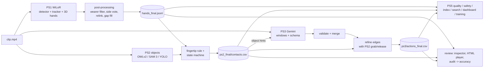

# Architecture

HandTrace is one pipeline in which every stage reads the files of the stages before it. The problem statements are
linked, not just stacked: PS2 uses PS1's fingertips, PS3 uses PS2's grab/release moments, and PS5 uses all of them.

## Stages and modules

| Stage | Entry point | Modules | Output per clip (`OUT_ROOT/<stem>/`) |
|---|---|---|---|
| PS1 | `runner.launch("ps1", ...)` | `wilor/pipeline.py` (detector → `hand_tracker.py` → `wilor_inference.py` → `smoothing.py` → gap fill), `postprocess.py`, `wilor/refine.py` | `hands.jsonl` (raw), `hands_final.jsonl`, `metrics.json`, `hands_meta.json`, `postprocess_report.json` |
| PS2 | `runner.launch("ps2", ...)` | `ps2/object_detector.py`, `ps2/object_tracker.py`, `ps2/contact_detector.py`, `ps2/state_machine.py`, `ps2/pipeline.py` | `ps2_final/object_detections.jsonl`, `contacts.jsonl`, `contacts.csv`, `ps2_metrics.json` |
| PS3 | `ps3.run_all(...)` | `ps3/windows.py`, `prompt.py`, `gemini_client.py`, `validate.py`, `merge.py`, `refine.py`, `pipeline.py`, `compare.py` | `ps3/raw/`, `actions.json/.csv`, `actions_final.json/.csv` |
| PS5 | `ps5.*.analyse_all`, `index.build_index`, `dashboard.write_html`, `training.make_training_video` | `ps5/quality.py`, `safety.py`, `index.py`, `search.py`, `dashboard.py`, `training.py` | `ps5/quality.json`, `ps5/safety_events.csv`; cross-clip `ps5_events_all.csv`, `ps5_dashboard.html` |
| Review | `review_widgets.inspector`, `review_html.export_review_html`, `review.audit_report` | `review.py`, `review_widgets.py`, `review_html.py`, `render.py` | `review/manual_audit.csv`, `review/<clip>_review.html`, `accuracy_report.json` |

`results.py` is the single place that knows every path above; all readers (PS5, review, notebook) go through it and
get an empty result, never an exception, when a stage has not run.

## Execution model

- **Runner** (`handtrace/runner.py`): `Settings` (JSON-serialisable) describes a run. `launch(stage, ...)` starts one
  worker process per GPU (`python -m handtrace.runner --stage ps1 --settings settings.json --worker-id k`). Workers
  claim clips with atomic lock files, so any number of them balance themselves, a finished clip is never repeated and
  an interrupted run resumes. A clip that raises is logged and skipped. `deadline` stops new clips from starting when
  they could not finish inside the session.
- **Completion markers**: PS1 is done when `hands_final.jsonl` and `postprocess_report.json` exist (the report is
  written last); PS2 when `ps2_final/ps2_metrics.json` exists; PS3 when `ps3/actions.json` exists. `force` redoes a
  stage only for outputs older than `force_since`.
- **CLI** (`handtrace/cli.py`): `python -m handtrace.cli {ps1|ps2|ps3|ps5|all}` runs stages in order on a folder of
  clips, with options from flags or a JSON `--config`.
- **Notebook** (`notebooks/HandTrace_Final_Pipeline.ipynb`): clones the repository, installs dependencies without
  touching the preinstalled torch/CUDA (`handtrace/environment.py`), prepares WiLoR assets
  (`wilor/setup_utils.prepare_wilor`), and calls the same runner, with progress, checks and review tools.

## Heavy dependencies are lazy

`torch`, `ultralytics`, `transformers`, WiLoR and `google-genai` are imported inside the functions that need them, so
post-processing, the PS2 contact logic, PS3 validation/merging, PS5 tools and the tests run on a CPU-only machine.
